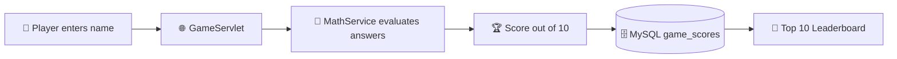

[README (2).md](https://github.com/user-attachments/files/34582246/README.2.md)
<a id="top"></a>

<div align="center">


**🎓 Java Web Application Development · Live Lab Test #2**


</div>

---

## 📋 Project Information

<div align="center">

| Field | Details |
|:---|:---|
| 👤 **Student Name** | **APURBO** |
| 🆔 **Student ID** | **IT24008** |
| 📌 **Project Title** | APURBO Math Whiz |
| 🧩 **Project Type** | Java Servlet & JDBC Web Application |
| 🎚️ **Difficulty** | NORMAL |
| 🏆 **Maximum Score** | 10 marks |
| 🖥️ **Application Server** | Apache Tomcat 11 |
| 🗄️ **Database** | MySQL (`math_whiz_db`) |

</div>

🔗 **Project:** `YOUR-GITHUB-PROJECT-LINK`

---

<a id="quick-navigation"></a>
## 🧭 Quick Navigation – All 10 Tasks

> 👇 Click any task to jump directly to its section.

<div align="center">

| # | Task | Jump |
|:-:|:---|:-:|
| 01 | 🛠️ Project Setup | [Go →](#task-01) |
| 02 | 🎨 Design the Game Interface | [Go →](#task-02) |
| 03 | 🔢 Prime Number Function | [Go →](#task-03) |
| 04 | ➗ Modulus Function | [Go →](#task-04) |
| 05 | 📐 Trigonometric Functions | [Go →](#task-05) |
| 06 | 🎮 Game Logic | [Go →](#task-06) |
| 07 | 🗄️ Database Design Using JDBC | [Go →](#task-07) |
| 08 | 🏅 Top 10 Leaderboard | [Go →](#task-08) |
| 09 | ✅ Testing and Validation | [Go →](#task-09) |
| 10 | 📦 Documentation & GitHub Submission | [Go →](#task-10) |

</div>

Also: [📖 Overview](#overview) · [🧰 Technologies](#technologies) · [☑️ Final Checklist](#checklist) · [🎓 Learning Outcomes](#outcomes) · [✍️ Author](#author)

---

<a id="overview"></a>
## 📖 Project Overview

**APURBO Math Whiz** is a web-based mathematical quiz game developed with **Java Servlets, JSP, JDBC, and MySQL**.

A player enters a name and answers four mathematical questions from three areas: **prime numbers**, **modulus operations**, and **trigonometry**. The server evaluates the submitted answers using Java methods, calculates a score out of **10**, saves the result in MySQL, and provides a **Top 10 leaderboard**.

> 💡 The purpose of this lab is to demonstrate mathematical method development, server-side processing, JDBC database operations, and leaderboard generation — not simply to display a quiz interface.

### 🔄 How It Works



---

<a id="technologies"></a>
## 🧰 Technologies Used

<div align="center">

| Technology | Purpose |
|:---|:---|
| ☕ **Java** | Mathematical logic and application processing |
| 🌐 **Java Servlet** | Server-side request handling |
| 📄 **JSP** | Dynamic web pages |
| 🔌 **JDBC** | Java-to-MySQL connectivity |
| 🐬 **MySQL** | Persistent score storage |
| 🐱 **Apache Tomcat 11** | Web application server |
| 📦 **Maven** | Dependency and build management |
| 💡 **IntelliJ IDEA** | Development environment |
| 🎨 **HTML & CSS** | User interface |

</div>

[⬆️ Back to top](#top)

---

<a id="task-01"></a>
## 🛠️ Task 01 – Project Setup

> **🎯 Objective:** Create and configure the Java web application environment.

**🏗️ Architecture:** The project uses a Servlet/JSP structure. Servlets receive browser requests, call the application logic and DAO classes, and forward data to JSP pages.

```text
MathWhiz/
├── database/
│   └── math_whiz_db.sql
├── src/
│   └── main/
│       ├── java/
│       │   └── com/mathwhiz/
│       │       ├── dao/
│       │       │   └── ScoreDAO.java
│       │       ├── model/
│       │       │   ├── GameQuestion.java
│       │       │   └── GameResult.java
│       │       ├── service/
│       │       │   └── MathService.java
│       │       └── servlet/
│       │           ├── GameServlet.java
│       │           └── LeaderboardServlet.java
│       └── webapp/
│           ├── css/
│           │   └── style.css
│           ├── index.jsp
│           ├── game.jsp
│           ├── result.jsp
│           └── leaderboard.jsp
├── pom.xml
├── .gitignore
└── README.md
```

### 📸 Screenshot 01 – IntelliJ IDEA Project Structure

<div align="center">


</div>

[⬆️ Back to navigation](#quick-navigation)

---

<a id="task-02"></a>
## 🎨 Task 02 – Design the Game Interface

> **🎯 Objective:** Create a user-friendly welcome page where a player can enter their name and start the challenge.

**Implemented interface elements:**

- ✅ Project title: **APURBO MATH WHIZ**
- ✅ Player name input field
- ✅ Start Game button
- ✅ Link to the Top 10 Leaderboard
- ✅ Difficulty level and maximum score information

The welcome form sends the player's name to the server using an **HTTP POST** request.

### 📸 Screenshot 02 – Welcome Page

<div align="center">


</div>

[⬆️ Back to navigation](#quick-navigation)

---

<a id="task-03"></a>
## 🔢 Task 03 – Prime Number Function

> **🎯 Objective:** Implement a reusable Java method that determines whether an integer is prime.

```java
public static int isPrime(int number)
```

**Expected behaviour**

- ✔️ Returns `1` when the number is prime.
- ✔️ Returns `0` when the number is not prime.
- ✔️ Numbers less than 2 are not prime.

<div align="center">

| Input | Expected Output |
|:-:|:-:|
| 7 | 1 |
| 8 | 0 |
| 1 | 0 |
| 2 | 1 |
| 13 | 1 |

</div>

The game uses this method to evaluate **Question 1**.

### 📸 Screenshot 03 – Prime Number Function

<div align="center">


</div>

[⬆️ Back to navigation](#quick-navigation)

---

<a id="task-04"></a>
## ➗ Task 04 – Modulus Function

> **🎯 Objective:** Implement a Java method that calculates the remainder of integer division.

```java
public static int calculateMod(int a, int b)
```

**Expected behaviour**

- ✔️ Accepts two integer operands.
- ✔️ Uses Java's `%` operator to calculate the remainder.
- ✔️ Handles a divisor of zero through validation instead of attempting the operation.

<div align="center">

| Expression | Expected Result |
|:-:|:-:|
| 17 % 5 | 2 |
| 20 % 3 | 2 |
| 15 % 4 | 3 |
| 10 % 0 | ❌ Validation error |

</div>

The game uses this method to evaluate **Question 2**.

### 📸 Screenshot 04 – Modulus Function

<div align="center">


</div>

[⬆️ Back to navigation](#quick-navigation)

---

<a id="task-05"></a>
## 📐 Task 05 – Trigonometric Functions

> **🎯 Objective:** Implement reusable Java methods to calculate sine, cosine, and tangent values.

```java
public static double calculateSin(double degree);
public static double calculateCos(double degree);
public static double calculateTan(double degree);
```

**Implementation requirements**

- ✔️ Accept angles in **degrees**.
- ✔️ Convert degrees into radians using `Math.toRadians()`.
- ✔️ Use `Math.sin()`, `Math.cos()`, and `Math.tan()`.
- ✔️ Handle undefined tangent values appropriately.
- ✔️ Compare decimal answers using a suitable tolerance.

<div align="center">

| Function | Input | Expected Result |
|:-:|:-:|:-:|
| Sine | 30° | 0.5 |
| Cosine | 60° | 0.5 |
| Tangent | 45° | 1.0 |

</div>

These methods are used to evaluate **Questions 3 and 4**.

### 📸 Screenshot 05 – Trigonometric Functions

<div align="center">


</div>

[⬆️ Back to navigation](#quick-navigation)

---

<a id="task-06"></a>
## 🎮 Task 06 – Implement the Game Logic

> **🎯 Objective:** Integrate the mathematical methods into a complete four-question game.

<div align="center">

| Question | Mathematical Area | Marks |
|:-:|:-:|:-:|
| Q1 | Prime number | 2 |
| Q2 | Modulus | 2 |
| Q3 | Trigonometry | 3 |
| Q4 | Trigonometry | 3 |
| **Total** | | **10** |

</div>

**🔁 Game workflow**

1. The player enters their name.
2. The server receives the player's name.
3. The application presents four mathematical questions.
4. The player enters an answer for each question.
5. The server evaluates the answers using the Java mathematical methods.
6. The application calculates the total score.
7. The result is displayed to the player.

**🧮 Scoring logic**

```java
int totalScore = 0;

if (primeCorrect) {
    totalScore += 2;
}

if (modCorrect) {
    totalScore += 2;
}

if (trig1Correct) {
    totalScore += 3;
}

if (trig2Correct) {
    totalScore += 3;
}
```

**🏆 Maximum score: 10 marks.**

### 📸 Screenshot 06 – Game Page

<div align="center">


</div>

### 📸 Screenshot 07 – Result Page

<div align="center">


</div>

[⬆️ Back to navigation](#quick-navigation)

---

<a id="task-07"></a>
## 🗄️ Task 07 – Database Design Using JDBC

> **🎯 Objective:** Connect the application to MySQL and store each completed game's score.

<div align="center">

| Item | Value |
|:-:|:-:|
| Database name | `math_whiz_db` |
| Table name | `game_scores` |

</div>

**📑 Table structure**

| Field | Data Type | Description |
|:---|:---|:---|
| `id` | INT | Primary key, auto increment |
| `player_name` | VARCHAR(100) | Player's name |
| `score` | INT | Final score |
| `difficulty` | VARCHAR(20) | Difficulty level |
| `played_at` | TIMESTAMP | Date and time of play |

**🧾 Database creation SQL** (file: `database/math_whiz_db.sql`)

```sql
CREATE DATABASE IF NOT EXISTS math_whiz_db;

USE math_whiz_db;

CREATE TABLE IF NOT EXISTS game_scores (
    id INT PRIMARY KEY AUTO_INCREMENT,
    player_name VARCHAR(100) NOT NULL,
    score INT NOT NULL,
    difficulty VARCHAR(20) NOT NULL DEFAULT 'NORMAL',
    played_at TIMESTAMP DEFAULT CURRENT_TIMESTAMP
);
```

**🔌 JDBC operations**

- ✔️ Establish a connection to MySQL.
- ✔️ Insert a player's name, score, difficulty, and playing date/time.
- ✔️ Retrieve saved scores.
- ✔️ Use `PreparedStatement` for parameterized SQL operations.

### 📸 Screenshot 08 – MySQL Database and Table

<div align="center">


</div>

### 📸 Screenshot 08B – Saved Game Records

```sql
USE math_whiz_db;

SELECT * FROM game_scores;
```

<div align="center">


</div>

[⬆️ Back to navigation](#quick-navigation)

---

<a id="task-08"></a>
## 🏅 Task 08 – Display the Top 10 Leaderboard

> **🎯 Objective:** Retrieve and display the ten highest scores from the database.

```sql
SELECT *
FROM game_scores
ORDER BY score DESC, played_at ASC
LIMIT 10;
```

**Leaderboard requirements**

- ✔️ Display no more than ten records.
- ✔️ Sort scores in descending order.
- ✔️ Use `played_at` in ascending order as the secondary sorting criterion.
- ✔️ Display player name, score, difficulty, and date/time.

### 📸 Screenshot 09 – Top 10 Leaderboard

<div align="center">


</div>

[⬆️ Back to navigation](#quick-navigation)

---

<a id="task-09"></a>
## ✅ Task 09 – Testing and Validation

> **🎯 Objective:** Test the mathematical functions, game scoring, input validation, and database operations.

<div align="center">

| Test Case | Input | Expected Result |
|:---|:---|:---|
| Prime number | 7 | 1 |
| Prime number | 8 | 0 |
| Prime number | 1 | 0 |
| Modulus | 17 % 5 | 2 |
| Sine | 30° | 0.5 |
| Cosine | 60° | 0.5 |
| Tangent | 45° | 1.0 |
| Zero divisor | 10 % 0 | Validation error |
| All answers correct | Four correct answers | 10 marks |
| Incorrect answers | One or more wrong answers | Corresponding marks are not awarded |

</div>

**🛡️ Validation rules**

- ✔️ Invalid modulus operations must be rejected.
- ✔️ Trigonometric values must be calculated from degree inputs.
- ✔️ Decimal answers must be checked using an appropriate tolerance.
- ✔️ Scores must be calculated on the server.
- ✔️ Completed game records must be checked in the database.

### 📸 Screenshot 10A – Mathematical Testing

<div align="center">


</div>

[⬆️ Back to navigation](#quick-navigation)

---

<a id="task-10"></a>
## 📦 Task 10 – Final Documentation and GitHub Submission

> **🎯 Objective:** Prepare the complete project for submission and document its implementation.

### 🧱 Software Requirements

- ☕ Java Development Kit (JDK)
- 💡 IntelliJ IDEA
- 🐱 Apache Tomcat 11
- 🐬 MySQL Server
- 🛠️ MySQL Workbench
- 🔌 MySQL Connector/J
- 📦 Maven

### ▶️ How to Run the Project

1. Open the project in IntelliJ IDEA.
2. Configure the JDK.
3. Reload Maven dependencies.
4. Start the MySQL server.
5. Execute `database/math_whiz_db.sql` in MySQL Workbench.
6. Configure the database connection URL, username, and password in the application's database connection settings.
7. Configure Apache Tomcat 11 in IntelliJ IDEA.
8. Deploy the web application to Tomcat.
9. Start the Tomcat server.
10. Open the deployed application in a browser.

### 🌍 Application URL

The context path depends on the artifact name configured in IntelliJ IDEA/Tomcat.

```text
http://localhost:8080/<your-context-path>/
```

Replace `<your-context-path>` with the actual deployed context path.

### 🔗 GitHub Submission

| Item | Link |
|:---|:---|
| GitHub Repository | `YOUR-GITHUB-REPOSITORY-LINK` |

### 📸 GitHub Repository

<div align="center">


</div>

[⬆️ Back to navigation](#quick-navigation)

---

<a id="checklist"></a>
## ☑️ Final Submission Checklist

- [x] Task 01 – Java web application setup and project structure
- [x] Task 02 – Welcome page and player name form
- [x] Task 03 – Prime number method
- [x] Task 04 – Modulus method and zero-divisor validation
- [x] Task 05 – Sine, cosine, and tangent methods
- [x] Task 06 – Four-question game and 10-mark scoring
- [x] Task 07 – JDBC connection and MySQL score storage
- [x] Task 08 – Top 10 leaderboard
- [x] Task 09 – Mathematical, validation, and database testing
- [x] Task 10 – README, SQL file, screenshots, and GitHub submission

---

<a id="outcomes"></a>
## 🎓 Learning Outcomes

This project provides practical experience in:

- 🧮 Developing reusable Java mathematical methods.
- 🔀 Applying conditional statements and decision-making logic.
- 🌐 Processing HTTP requests and responses using Servlets.
- 🔌 Connecting Java applications to MySQL using JDBC.
- 🛡️ Using `PreparedStatement` for parameterized SQL operations.
- 📊 Retrieving, sorting, and displaying database records.
- 📄 Developing a Java Servlet/JSP web application.
- 🚀 Documenting and submitting a software project through GitHub.

---

<a id="author"></a>
## ✍️ Author

<div align="center">

### **APURBO**
🆔 Student ID: **IT24008**

⭐ *Made with Java, Servlets & a lot of math* ⭐


[⬆️ Back to top](#top)

</div>

